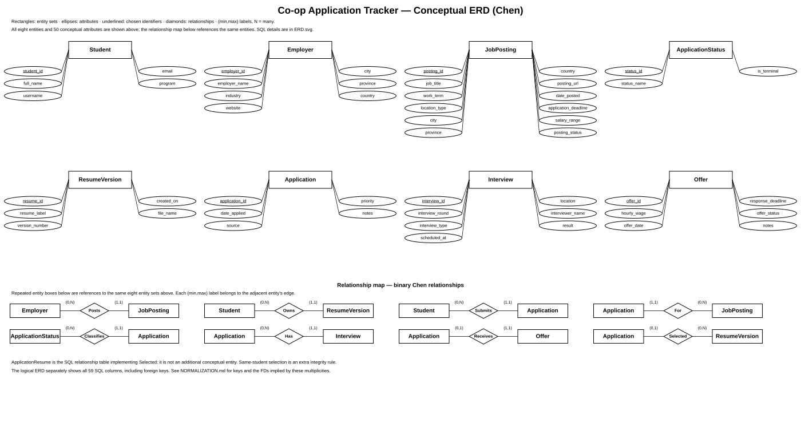

# Conceptual ERD — Chen notation

This is the **conceptual** design, using the course's Chen-style shapes: entity sets are rectangles, attributes are ellipses, identifiers are underlined, and relationships are diamonds. It is black on white. To keep 50 attributes legible, the SVG uses an attribute view and a relationship view; repeated entity names in the relationship view are reference labels for the same entity sets, not additional entity sets. Read the relationship table below as the exact mapping between views.

The conceptual model has eight entity sets and eight binary relationships. It distinguishes requirements from implementation: SQL datatypes, nullable markers, foreign keys, checks and alternate keys belong in the relational schema and DDL, not as conceptual attributes.

## Attribute coverage

| Entity set | Conceptual attributes (chosen identifier underlined in diagram) |
| --- | --- |
| Student | student_id, full_name, username, email, program |
| Employer | employer_id, employer_name, industry, website, city, province, country |
| JobPosting | posting_id, job_title, work_term, location_type, city, province, country, posting_url, date_posted, application_deadline, salary_range, posting_status |
| ApplicationStatus | status_id, status_name, is_terminal |
| ResumeVersion | resume_id, resume_label, version_number, created_on, file_name |
| Application | application_id, date_applied, source, priority, notes |
| Interview | interview_id, interview_round, interview_type, scheduled_at, location, interviewer_name, result |
| Offer | offer_id, hourly_wage, offer_date, response_deadline, offer_status, notes |

The **50 conceptual attributes** include the chosen identifiers. Nine SQL foreign-key columns are represented by relationships rather than repeated as conceptual attributes. The logical schema therefore has 59 columns across nine tables, all listed in [ERD.md](ERD.md), [RELATIONAL_SCHEMA.md](RELATIONAL_SCHEMA.md), [ERD.svg](ERD.svg), and [schema.sql](schema.sql). In particular, JobPosting has 12 conceptual attributes; `employer_id` is represented by Employer–Posts–JobPosting, while the relational view shows all 13 SQL columns.

## Relationship multiplicities and relational mapping

The labels `(min,max)` give each entity's participation count. These are explicit min/max labels; they are not crow's-foot endpoints.

| Relationship | Entity participation | SQL reference columns / implementation |
| --- | --- | --- |
| Employer Posts JobPosting | Employer (0,N); JobPosting (1,1) | JobPosting.employer_id |
| Student Owns ResumeVersion | Student (0,N); ResumeVersion (1,1) | ResumeVersion.student_id |
| Student Submits Application | Student (0,N); Application (1,1) | Application.student_id |
| Application For JobPosting | Application (1,1); JobPosting (0,N) | Application.posting_id |
| ApplicationStatus Classifies Application | ApplicationStatus (0,N); Application (1,1) | Application.status_id |
| Application Has Interview | Application (0,N); Interview (1,1) | Interview.application_id |
| Application Receives Offer | Application (0,1); Offer (1,1) | Offer.application_id; at most one offer per application |
| Application Selected ResumeVersion | Application (0,1); ResumeVersion (0,N) | ApplicationResume(application_id, resume_id); application_id identifies this optional relationship |

Application is an entity because it has lifecycle attributes and participates in Interview and Offer. `(student_id, posting_id)` is an additional candidate key, enforced in SQL; neither student nor posting alone identifies an application. Interview's chosen identifier is interview_id; `(application_id, interview_round)` is an alternate key. The alternate keys are documented in [RELATIONAL_SCHEMA.md](RELATIONAL_SCHEMA.md).

The child identifier determines its parent identifier in each many-to-one relationship: for example, `application_id -> posting_id`. The reverse does not follow. An optional Selected relationship determines `resume_id` only for rows in the assignment relation. Resume ownership additionally implies `resume_id -> student_id`; the decomposition and enforcement of same-student ownership are explained in [NORMALIZATION.md](NORMALIZATION.md) and [docs/CONSTRAINTS.md](docs/CONSTRAINTS.md).

The design follows the supplied CSC 370 course material on conceptual design, multiplicities and ERDs-to-FDs. Its 13 lesson-module PDFs (510 pages/slides) were reviewed. The model's assumptions and decisions about weak entities and inheritance are in [docs/CONSTRAINTS.md](docs/CONSTRAINTS.md). The files in [evidence/](evidence/README.md) include recorded checks of conceptual attribute and relationship mapping.
